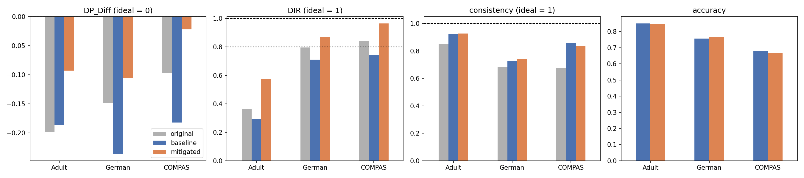

# reweighing-fairness-preprocessing-technique

Evaluation of Reweighing (Kamiran & Calders, 2012), a pre-processing bias-mitigation method, on the Adult, German Credit and COMPAS datasets. Compares demographic parity difference, disparate impact ratio, consistency and accuracy before and after mitigation, using the Reweighing implementation of [AIF360](https://github.com/Trusted-AI/AIF360).

## Repository contents

| File / folder | Description |
|---|---|
| `reweighing_evaluation.ipynb` | The full analysis, with all outputs saved |
| `requirements.txt` | Python packages and versions used |
| `results/comparison.csv` | Fairness and accuracy before and after mitigation |
| `results/fairness_comparison.png` | Bar chart of the results |

## How to reproduce the results

Tested with Python 3.9.

1. Clone the repository:
   ```bash
   git clone https://github.com/anthonyhsg/reweighing-fairness-preprocessing-technique.git
   cd reweighing-fairness-preprocessing-technique
   ```
2. Create a virtual environment and install the packages:
   ```bash
   python3 -m venv .venv
   source .venv/bin/activate        # Windows: .venv\Scripts\activate
   pip install -r requirements.txt
   ```
3. Open `reweighing_evaluation.ipynb` in VS Code, select the `.venv` kernel and click **Run All**.
   To use Jupyter in the browser instead, first run `pip install jupyter`, then `jupyter notebook`.

The first cell downloads the raw datasets and places them in AIF360's data folder, so no manual download is needed. The output tables and figure are written to `results/`.

## Data

| Dataset | Source | Favourable label | Sensitive attribute (privileged) |
|---|---|---|---|
| Adult | [UCI](https://archive.ics.uci.edu/dataset/2/adult) | income > 50K | sex (male) |
| German Credit | [UCI](https://archive.ics.uci.edu/dataset/144/statlog+german+credit+data) | good credit | age (> 25) |
| COMPAS | [ProPublica](https://github.com/propublica/compas-analysis) | no recidivism within 2 years | race (Caucasian) |

## Method and settings

| Component | Setting |
|---|---|
| Train/test split | 70% / 30%, stratified on sensitive attribute × label, `random_state = 42` |
| Reweighing | AIF360 implementation, parameter-free; fitted on the training set only |
| Classifier | Logistic regression with `StandardScaler`, `max_iter = 1000`, otherwise scikit-learn defaults |
| Models | Baseline (no weights) and mitigated (Reweighing weights as `sample_weight`) |
| Fairness measures | DP_Diff (unprivileged − privileged; ideal 0), DIR (ideal 1), consistency (k = 5; ideal 1) |
| Performance measure | Accuracy |

Fairness is measured on the original labels of the full dataset (before mitigation) and on the test-set predictions of both models.

## Results

| Dataset | Stage | DP_Diff | DIR | Consistency | Accuracy |
|---|---|---|---|---|---|
| Adult | original | −0.199 | 0.363 | 0.849 | – |
| | baseline | −0.186 | 0.295 | 0.925 | 0.850 |
| | mitigated | −0.093 | 0.572 | 0.926 | 0.844 |
| German | original | −0.149 | 0.795 | 0.681 | – |
| | baseline | −0.236 | 0.711 | 0.726 | 0.757 |
| | mitigated | −0.105 | 0.870 | 0.742 | 0.767 |
| COMPAS | original | −0.097 | 0.840 | 0.676 | – |
| | baseline | −0.182 | 0.744 | 0.858 | 0.679 |
| | mitigated | −0.022 | 0.964 | 0.838 | 0.666 |



Reweighing moved DP_Diff towards zero and increased DIR on all three datasets, with DIR passing the 0.8 threshold for German and COMPAS. Accuracy changed by at most 1.3 percentage points and consistency by at most 0.02. For Adult, a substantial gap between the groups remains.

## Reference

Kamiran, F., & Calders, T. (2012). Data preprocessing techniques for classification without discrimination. *Knowledge and Information Systems*, 33(1), 1–33. https://doi.org/10.1007/s10115-011-0463-8